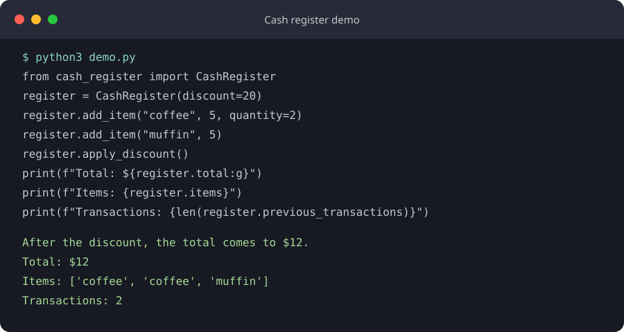

# Cash Register

A small Python cash register model for recording item purchases, applying a
percentage discount, and voiding the most recent transaction.

## Features

- Tracks the running total and item names.
- Records each purchase in `previous_transactions` with its item, unit price,
  and quantity.
- Accepts an integer discount from 0 to 100. Invalid discounts print
  `Not valid discount` and are set to 0.
- Applies a configured discount to the current total and prints the updated
  amount.
- Voids the most recent transaction, updating the total and item list.

## Requirements

- Python 3
- pytest to run the test suite

## Usage

Run this from the `lib` directory:

```python
from cash_register import CashRegister

register = CashRegister(discount=20)
register.add_item("coffee", 5, quantity=2)
register.add_item("muffin", 5)
register.apply_discount()
print(f"Total: ${register.total:g}")
print(f"Items: {register.items}")
print(f"Transactions: {len(register.previous_transactions)}")
```

`add_item` defaults to a quantity of 1. Calling `void_last_transaction()`
removes the most recently recorded purchase; calling it with no transactions
prints `There is no transaction to void.` Calling `apply_discount()` when there
is no configured discount or no recorded transaction prints
`There is no discount to apply.`

## Example run

The terminal capture below demonstrates the register after adding items and
applying a 20% discount.



## Tests

From the repository root, run:

```bash
python -m pytest -q
```
